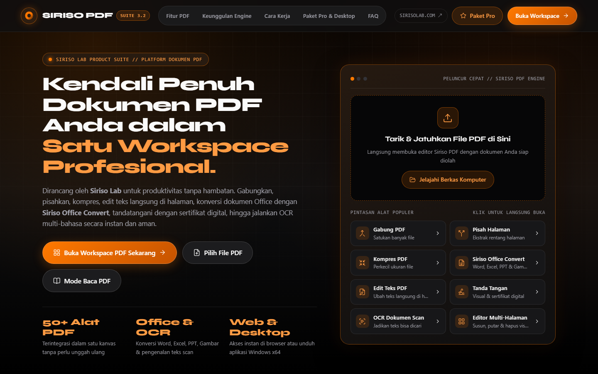
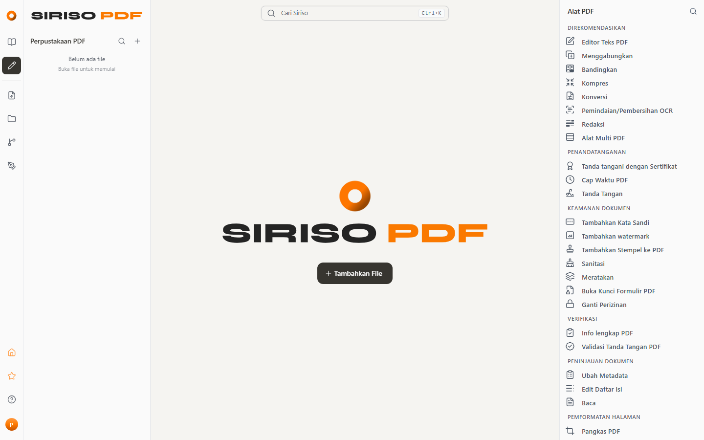
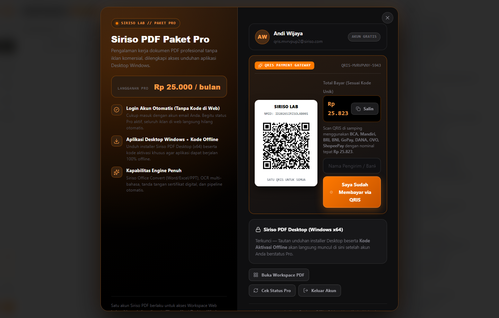

<p align="center">
  
</p>

<h1 align="center">Siriso PDF — Studio Dokumen PDF Profesional oleh Siriso Lab</h1>

<p align="center">
  Platform pengolahan, konversi, tanda tangan sertifikat digital, OCR, dan otomatisasi dokumen PDF berkecepatan tinggi dengan identitas visual <strong>Carbon Obsidian &amp; Siriso Orange</strong>. Tersedia sebagai <strong>Aplikasi Web</strong> maupun <strong>Aplikasi Desktop Windows (x64 Offline)</strong>.
</p>

<p align="center">
  <a href="https://sirisolab.com">
    
  </a>
  <a href="https://github.com/hanzputram/SirisoPDF">
    
  </a>
  <a href="https://sirisolab.com">
    
  </a>
  <a href="https://sirisolab.com">
    
  </a>
</p>

---

## Tampilan Antarmuka Siriso PDF

### 1. Landing Page & Katalog Fitur Interaktif


### 2. Workspace Studio PDF (Bebas Iklan Non-Resmi & Terproteksi Akun)


### 3. Checkout Paket Pro & Payment Gateway QRIS Terintegrasi


---

## Fitur Utama Siriso PDF

- **50+ Alat Manipulasi PDF Presisi Tinggi** — Gabungkan (*Merge*), pisahkan (*Split*), urutkan halaman secara visual, kompres ukuran file ekstrem, rotasi, dan sunting teks langsung di atas kanvas PDF.
- **Siriso Office Convert & Multi-Format** — Konversi dua arah berkecepatan tinggi antara PDF dengan dokumen **Microsoft Word (`.docx`)**, **Excel (`.xlsx`)**, **PowerPoint (`.pptx`)**, gambar resolusi tinggi (`PNG`/`JPG`/`WEBP`), HTML, dan Markdown.
- **OCR Multi-Bahasa & Pembersihan Hasil Scan** — Ekstraksi teks otomatis dari dokumen hasil pindaian (*scan*) agar dapat dicari (*searchable*) dan disalin dengan akurasi tinggi.
- **Keamanan Dokumen, Redaksi Permanen & Sertifikat Digital** — Enkripsi kata sandi AES-256, tanda tangan elektronik & sertifikat digital (`PKCS#12` / `X.509`), sanitasi metadata tersembunyi, serta redaksi permanen untuk dokumen rahasia.
- **Sistem Akun Terpadu & Payment Gateway QRIS (`Rp 25.000 / bulan`)**:
  - **Akses Workspace Terproteksi Akun**: Pengguna masuk/daftar akun dengan email dan kata sandi untuk mengakses Workspace PDF.
  - **Checkout QRIS Otomatis (Kode Unik 3 Digit)**: Mendukung pembayaran langsung ke QRIS merchant Anda (BCA, Mandiri, BRI, BNI, GoPay, DANA, OVO, ShopeePay) dengan nominal unik `Rp 25.xxx` dan generator payload **EMVCo Dynamic QRIS (`CRC-16/CCITT-FALSE`)**.
  - **100% Bebas Iklan di Web & Kode Offline Aplikasi Desktop Windows**: Begitu pembayaran QRIS terverifikasi, akun web langsung bebas iklan secara otomatis (tanpa perlu input kode di web) dan membuka unduhan installer **Siriso PDF Desktop (Windows x64)** beserta **Kode Aktivasi Offline** (`SRP-DESK-XXXX-XXXX`).

---

## Arsitektur Sistem

| Komponen | Direktori / Lokasi | Deskripsi |
| :--- | :--- | :--- |
| **Frontend Web & Workspace** | `frontend/` | Aplikasi SPA berbasis React 19 + TypeScript + Vite + Mantine UI dengan tema *Carbon Obsidian & Siriso Orange*. |
| **Landing Page & Modul Pro/QRIS** | `frontend/src/editor/core/components/shared/siriso/` | Komponen `SirisoLandingPage`, `SirisoProModal` (Auth + Checkout QRIS), dan slot iklan Google AdSense resmi. |
| **Backend PDF Engine** | `app/` & `dist/native/stirling-pdf.jar` | Layanan Spring Boot + PDFBox + LibreOffice + PDF.js untuk pemrosesan dokumen PDF skala besar. |
| **Desktop Launcher (Windows)** | `desktop/cef/` & `frontend/src-tauri/` | Paket aplikasi desktop untuk penggunaan lokal/offline di Windows x64. |

---

## Cara Menjalankan di Lokal & Server Android Termux (Port 5000)

### 1. Menjalankan di Server Android (Termux) — Port `5000`
Server khusus Android Termux (`termux/server-5000.mjs`) sudah menyertakan bundle web produksi siap pakai (`termux/siriso-web-dist.tar.gz`) sehingga perangkat Android tidak perlu melakukan kompilasi berat:

```bash
pkg update -y && pkg install -y git nodejs tar
git clone https://github.com/hanzputram/SirisoPDF.git
cd SirisoPDF
bash termux/start-5000.sh
```

Untuk menjalankan di *background* (24/7 dengan `termux-wake-lock` dan `nohup`):
```bash
bash termux/start-5000.sh --bg
```
Buka di browser: **`http://localhost:5000`** (atau **`http://<IP-ANDROID>:5000`** dari perangkat lain di jaringan Wi-Fi yang sama).

### 2. Menjalankan Server Produksi Java (`stirling-pdf.jar`) di Port `5000`
```powershell
java -Dserver.port=5000 -jar dist\native\stirling-pdf.jar --server.port=5000
```
Buka di browser: **`http://localhost:5000`**

### 3. Menjalankan Mode Pengembangan Frontend (`Vite`) di Port `5000`
```powershell
cd frontend
npm install
npx vite --mode core --host 0.0.0.0 --port 5000
```
Buka di browser: **`http://localhost:5000`**

### 4. Menggunakan Task Runner (`Taskfile`)
```bash
task dev            # Menjalankan backend + frontend secara bersamaan
task frontend:check # Menjalankan lint, theme-lint, icon-lint, typecheck, dan unit test frontend
task backend:check  # Menjalankan pemeriksaan kualitas kode backend Java
```

---

## Manajemen Backoffice & Upload QRIS

Pengaturan harga langganan **Paket Pro**, manajemen akun pelanggan, upload gambar **QRIS Merchant**, konfigurasi **EMVCo Static/Dynamic QRIS**, serta verifikasi transaksi pembayaran QRIS dikelola melalui **Backoffice Siriso Lab** (`http://localhost:8000/admin#/siriso-pdf-qris`).

- **Endpoint Webhook Mutasi QRIS Otomatis**:
  - `POST /api/siriso-pdf/payment/webhook`
  - Header: `x-qris-secret: siriso-qris-webhook-2026`
  - Payload JSON: `{ "amount": 25823 }` atau `{ "orderId": "QRIS-..." }`

---

## Paywall di Sisi Server (`siriso.enforceAccess`)

Gerbang Workspace di browser hanya tampilan: tanpa pengaturan ini, siapa pun bisa memanggil API pengolahan PDF (`/api/v1/**`) langsung dengan `curl`. Dengan `siriso.enforceAccess: true`, engine Java menolak setiap panggilan `/api/v1/**` yang tidak membawa token pelanggan Siriso (`Authorization: Bearer <token>`) milik akun yang diberi akses Workspace oleh backoffice. Keputusan diambil dari `user.access.workspace` pada `GET /api/siriso-pdf/auth/me` di backoffice, yang sudah memperhitungkan peran (Pelanggan/Tim Siriso/Admin), status Paket Pro, dan kebijakan akses.

Aktifkan di `configs/custom_settings.yml` (berkas deployment, tidak masuk git), lalu restart engine:

```yaml
siriso:
  enforceAccess: true                     # bawaan false: lokal/dev tetap terbuka
  backofficeUrl: "http://localhost:8000"  # origin backoffice yang melayani /api/siriso-pdf/auth/me
  cacheSeconds: 60                        # lama hasil cek token diingat per token
  timeoutSeconds: 5                       # batas waktu panggilan ke backoffice
```

Variabel lingkungan juga bisa dipakai: `SIRISO_ENFORCEACCESS=true`, `SIRISO_BACKOFFICEURL=https://sirisolab.com`.

| Kondisi | Status | Header `X-Siriso-Access` |
| :--- | :--- | :--- |
| Tanpa token, token kedaluwarsa/palsu, atau akun dihapus | `401` | `login-required` |
| Akun gratis tanpa akses Workspace | `402` | `pro-required` |
| Backoffice tidak bisa dihubungi | `503` | `unavailable` |
| Akun Pro, Tim Siriso, atau Admin | diteruskan ke alat PDF | — |

- **Tetap terbuka tanpa token**: `/api/v1/config/**` (termasuk `app-config`), `/api/v1/ui-data/**`, `/api/v1/info/status`, serta semua yang di luar `/api/v1/` (halaman web, aset, dan probe `/api/siriso-pdf/*`).
- **Cache**: izin dan token tidak valid diingat selama `cacheSeconds`, sehingga Pro yang berakhir atau peran yang dicabut berlaku paling lambat dalam rentang itu. Penolakan akun gratis hanya diingat 5 detik agar akun yang baru membayar langsung bisa memakai alat. Gangguan backoffice tidak pernah di-cache.
- **Frontend** otomatis mengirim token akun yang sedang masuk ke engine, dan menanggapi penolakan dengan memeriksa ulang akun, bukan mengarahkan ke `/login`.
- **Belum didukung saat aktif**: unggahan Mobile Scanner/tanda tangan dari ponsel (ponsel tidak punya sesi Siriso), sesi web yang hanya diaktifkan dengan kode aktivasi desktop tanpa login akun, engine yang dipanggil dari origin lain (respons penolakan tidak membawa header CORS), dan build *proprietary* dengan login Stirling (header `Authorization` di sana dipakai JWT Stirling). Pengaturan ini dirancang untuk build `core` yang dipakai `dist/native/stirling-pdf.jar`.

Uji cepat (`Sample.pdf` ada di `frontend/public/samples/`; token ada di `localStorage` kunci `siriso_pro_auth_v1` → `authToken`, atau di respons `POST /api/siriso-pdf/auth/login`):

```bash
curl -i -X POST http://localhost:5000/api/v1/general/rotate-pdf -F fileInput=@frontend/public/samples/Sample.pdf -F angle=90
```

```bash
curl -i -X POST http://localhost:5000/api/v1/general/rotate-pdf -H "Authorization: Bearer <token>" -F fileInput=@frontend/public/samples/Sample.pdf -F angle=90
```

---

## Lisensi & Hak Cipta

Dikembangkan dan dikelola oleh **Siriso Lab** ([sirisolab.com](https://sirisolab.com)). Lihat berkas [LICENSE](LICENSE) untuk informasi lisensi selengkapnya.
